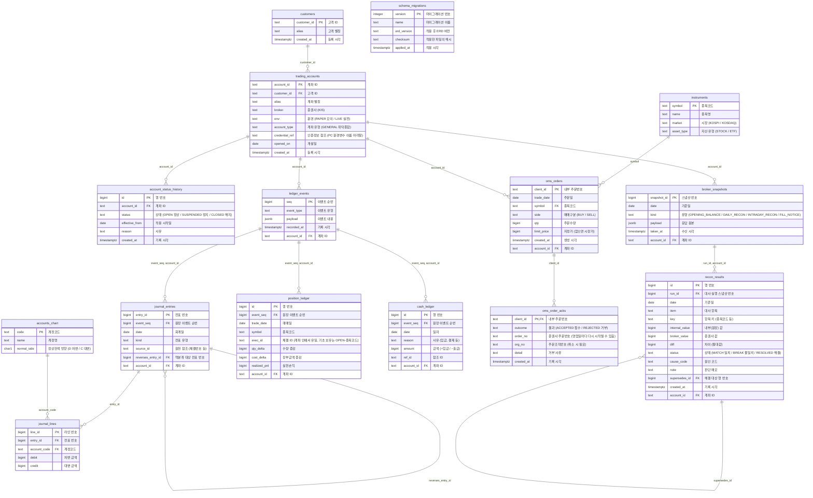

# MiniSTP ERD

ERD 버전: v2.0 · 스키마 해시: `aa861c56a169`

이 문서는 `scripts/gen_erd.py`가 `src/ministp/store/schema.sql`로 만든 DB에서 읽어 생성해요. 직접 고치지 말고 스키마의 한글 주석(COMMENT)을 고친 뒤 다시 생성하세요. 모든 원장 테이블은 append-only(수정·삭제 불가)예요.

## 관계도

## 데이터 사전

### accounts_chart — 계정과목 (테이블)

| 컬럼 | 한글명 | 타입 | 필수 | 키 |
|---|---|---|---|---|
| `code` | 계정코드 | text | Y | PK |
| `name` | 계정명 | text | Y |  |
| `normal_side` | 정상잔액 방향 (D 차변 / C 대변) | character(1) | Y |  |

### customers — 고객 (별칭만 관리, 개인정보 없음) (테이블)

| 컬럼 | 한글명 | 타입 | 필수 | 키 |
|---|---|---|---|---|
| `customer_id` | 고객 ID | text | Y | PK |
| `alias` | 고객 별칭 | text | Y |  |
| `created_at` | 등록 시각 | timestamp with time zone | Y |  |

### trading_accounts — 위탁계좌 (계좌번호·인증키는 DB에 없음) (테이블)

| 컬럼 | 한글명 | 타입 | 필수 | 키 |
|---|---|---|---|---|
| `account_id` | 계좌 ID | text | Y | PK |
| `customer_id` | 고객 ID | text | Y | FK → customers.customer_id |
| `alias` | 계좌 별칭 | text | Y |  |
| `broker` | 증권사 (KIS) | text | Y |  |
| `env` | 환경 (PAPER 모의 / LIVE 실전) | text | Y |  |
| `account_type` | 계좌 유형 (GENERAL 위탁종합) | text | Y |  |
| `credential_ref` | 인증정보 참조 (PC 환경변수 이름 머리말) | text | Y |  |
| `opened_on` | 개설일 | date | Y |  |
| `created_at` | 등록 시각 | timestamp with time zone | Y |  |

### account_status_history — 계좌 상태 이력 (변경은 새 행으로 추가) (테이블)

| 컬럼 | 한글명 | 타입 | 필수 | 키 |
|---|---|---|---|---|
| `id` | 행 번호 | bigint | Y | PK |
| `account_id` | 계좌 ID | text | Y | FK → trading_accounts.account_id |
| `status` | 상태 (OPEN 정상 / SUSPENDED 정지 / CLOSED 해지) | text | Y |  |
| `effective_from` | 적용 시작일 | date | Y |  |
| `reason` | 사유 | text |  |  |
| `created_at` | 기록 시각 | timestamp with time zone | Y |  |

### ledger_events — 원장 이벤트 (모든 기록의 원천, 수정·삭제 불가) (테이블)

| 컬럼 | 한글명 | 타입 | 필수 | 키 |
|---|---|---|---|---|
| `seq` | 이벤트 순번 | bigint | Y | PK |
| `event_type` | 이벤트 유형 | text | Y |  |
| `payload` | 이벤트 내용 | jsonb | Y |  |
| `recorded_at` | 기록 시각 | timestamp with time zone | Y |  |
| `account_id` | 계좌 ID | text | Y | FK → trading_accounts.account_id |

### journal_entries — 분개 전표 (테이블)

| 컬럼 | 한글명 | 타입 | 필수 | 키 |
|---|---|---|---|---|
| `entry_id` | 전표 번호 | bigint | Y | PK |
| `event_seq` | 원장 이벤트 순번 | bigint | Y | FK → ledger_events.seq |
| `date` | 회계일 | date | Y |  |
| `kind` | 전표 유형 | text | Y |  |
| `source_id` | 원천 참조 (체결번호 등) | text | Y |  |
| `reverses_entry_id` | 역분개 대상 전표 번호 | bigint |  | FK → journal_entries.entry_id |
| `account_id` | 계좌 ID | text | Y | FK → ledger_events.account_id |

### journal_lines — 분개 명세 (차변·대변 라인) (테이블)

| 컬럼 | 한글명 | 타입 | 필수 | 키 |
|---|---|---|---|---|
| `line_id` | 라인 번호 | bigint | Y | PK |
| `entry_id` | 전표 번호 | bigint | Y | FK → journal_entries.entry_id |
| `account_code` | 계정코드 | text | Y | FK → accounts_chart.code |
| `debit` | 차변 금액 | bigint | Y |  |
| `credit` | 대변 금액 | bigint | Y |  |

### position_ledger — 보유수량 원장 (매매일 기준) (테이블)

| 컬럼 | 한글명 | 타입 | 필수 | 키 |
|---|---|---|---|---|
| `id` | 행 번호 | bigint | Y | PK |
| `event_seq` | 원장 이벤트 순번 | bigint | Y | FK → ledger_events.seq |
| `trade_date` | 매매일 | date | Y |  |
| `symbol` | 종목코드 | text | Y |  |
| `exec_id` | 체결 ID (계좌 안에서 유일, 기초 보유는 OPEN-종목코드) | text | Y |  |
| `qty_delta` | 수량 증감 | bigint | Y |  |
| `cost_delta` | 장부금액 증감 | bigint | Y |  |
| `realized_pnl` | 실현손익 | bigint |  |  |
| `account_id` | 계좌 ID | text | Y | FK → ledger_events.account_id |

### cash_ledger — 예수금 원장 (결제일 기준) (테이블)

| 컬럼 | 한글명 | 타입 | 필수 | 키 |
|---|---|---|---|---|
| `id` | 행 번호 | bigint | Y | PK |
| `event_seq` | 원장 이벤트 순번 | bigint | Y | FK → ledger_events.seq |
| `date` | 일자 | date | Y |  |
| `reason` | 사유 (입금, 결제 등) | text | Y |  |
| `amount` | 금액 (+입금 / −출금) | bigint | Y |  |
| `ref_id` | 참조 ID | text | Y |  |
| `account_id` | 계좌 ID | text | Y | FK → ledger_events.account_id |

### instruments — 종목 마스터 (테이블)

| 컬럼 | 한글명 | 타입 | 필수 | 키 |
|---|---|---|---|---|
| `symbol` | 종목코드 | text | Y | PK |
| `name` | 종목명 | text | Y |  |
| `market` | 시장 (KOSPI / KOSDAQ) | text | Y |  |
| `asset_type` | 자산 유형 (STOCK / ETF) | text | Y |  |

### oms_orders — 주문 의도 (증권사 전송 전 기록) (테이블)

| 컬럼 | 한글명 | 타입 | 필수 | 키 |
|---|---|---|---|---|
| `client_id` | 내부 주문번호 | text | Y | PK |
| `trade_date` | 주문일 | date | Y |  |
| `symbol` | 종목코드 | text | Y | FK → instruments.symbol |
| `side` | 매매구분 (BUY / SELL) | text | Y |  |
| `qty` | 주문수량 | bigint | Y |  |
| `limit_price` | 지정가 (없으면 시장가) | bigint |  |  |
| `created_at` | 생성 시각 | timestamp with time zone | Y |  |
| `account_id` | 계좌 ID | text | Y | FK → trading_accounts.account_id |

### oms_order_acks — 주문 접수 결과 (증권사 응답) (테이블)

| 컬럼 | 한글명 | 타입 | 필수 | 키 |
|---|---|---|---|---|
| `client_id` | 내부 주문번호 | text | Y | PK, FK → oms_orders.client_id |
| `outcome` | 결과 (ACCEPTED 접수 / REJECTED 거부) | text | Y |  |
| `order_no` | 증권사 주문번호 (영업일마다 다시 시작될 수 있음) | text |  |  |
| `org_no` | 주문조직번호 (취소 시 필요) | text |  |  |
| `detail` | 거부 사유 | text |  |  |
| `created_at` | 기록 시각 | timestamp with time zone | Y |  |

### broker_snapshots — 증권사 응답 원본 (대사 실행, 체결통보, 원장 시작) (테이블)

| 컬럼 | 한글명 | 타입 | 필수 | 키 |
|---|---|---|---|---|
| `snapshot_id` | 스냅샷 번호 | bigint | Y | PK |
| `date` | 기준일 | date | Y |  |
| `kind` | 유형 (OPENING_BALANCE / DAILY_RECON / INTRADAY_RECON / FILL_NOTICE) | text | Y |  |
| `payload` | 응답 원본 | jsonb | Y |  |
| `taken_at` | 수신 시각 | timestamp with time zone | Y |  |
| `account_id` | 계좌 ID | text | Y | FK → trading_accounts.account_id |

### recon_results — 대사 결과 (판단은 새 행으로 추가) (테이블)

| 컬럼 | 한글명 | 타입 | 필수 | 키 |
|---|---|---|---|---|
| `id` | 행 번호 | bigint | Y | PK |
| `run_id` | 대사 실행 스냅샷 번호 | bigint | Y | FK → broker_snapshots.snapshot_id |
| `date` | 기준일 | date | Y |  |
| `item` | 대사 항목 | text | Y |  |
| `key` | 항목 키 (종목코드 등) | text | Y |  |
| `internal_value` | 내부(원장) 값 | bigint | Y |  |
| `broker_value` | 증권사 값 | bigint | Y |  |
| `diff` | 차이 (절대값) | bigint | Y |  |
| `status` | 상태 (MATCH 일치 / BREAK 불일치 / RESOLVED 해결) | text | Y |  |
| `cause_code` | 원인 코드 | text |  |  |
| `note` | 판단 메모 | text |  |  |
| `supersedes_id` | 해결 대상 행 번호 | bigint |  | FK → recon_results.id |
| `created_at` | 기록 시각 | timestamp with time zone | Y |  |
| `account_id` | 계좌 ID | text | Y | FK → broker_snapshots.account_id |

### schema_migrations — 스키마 마이그레이션 적용 기록 (테이블)

| 컬럼 | 한글명 | 타입 | 필수 | 키 |
|---|---|---|---|---|
| `version` | 마이그레이션 번호 | integer | Y | PK |
| `name` | 마이그레이션 이름 | text | Y |  |
| `erd_version` | 적용 후 ERD 버전 | text |  |  |
| `checksum` | 적용한 파일의 해시 | text | Y |  |
| `applied_at` | 적용 시각 | timestamp with time zone | Y |  |

### account_balances_v — 계좌별·계정별 잔액 (시산표) (뷰)

| 컬럼 | 한글명 | 타입 | 필수 | 키 |
|---|---|---|---|---|
| `account_id` | 계좌 ID | text |  |  |
| `code` | 계정코드 | text |  |  |
| `name` | 계정명 | text |  |  |
| `normal_side` | 정상잔액 방향 | character(1) |  |  |
| `balance` | 잔액 | numeric |  |  |

### positions_v — 계좌별·종목별 보유 현황 (뷰)

| 컬럼 | 한글명 | 타입 | 필수 | 키 |
|---|---|---|---|---|
| `account_id` | 계좌 ID | text |  |  |
| `symbol` | 종목코드 | text |  |  |
| `qty` | 보유수량 | numeric |  |  |
| `book_cost` | 장부금액 (매입금액) | numeric |  |  |

### cash_balance_v — 계좌별 예수금 잔액 (뷰)

| 컬럼 | 한글명 | 타입 | 필수 | 키 |
|---|---|---|---|---|
| `account_id` | 계좌 ID | text |  |  |
| `balance` | 잔액 | numeric |  |  |

### account_status_v — 계좌별 현재 상태 (뷰)

| 컬럼 | 한글명 | 타입 | 필수 | 키 |
|---|---|---|---|---|
| `account_id` | 계좌 ID | text |  |  |
| `customer_id` | 고객 ID | text |  |  |
| `alias` | 계좌 별칭 | text |  |  |
| `status` | 현재 상태 | text |  |  |
| `effective_from` | 상태 적용 시작일 | date |  |  |

### customer_positions_v — 고객별·종목별 보유 합계 (여러 계좌 합산) (뷰)

| 컬럼 | 한글명 | 타입 | 필수 | 키 |
|---|---|---|---|---|
| `customer_id` | 고객 ID | text |  |  |
| `symbol` | 종목코드 | text |  |  |
| `qty` | 보유수량 | numeric |  |  |
| `book_cost` | 장부금액 (매입금액) | numeric |  |  |

## 변경 이력

| 버전 | 일자 | 변경 내용 |
|---|---|---|
| v1.0 | 2026-11-21 | 최초 공개. 원장(이벤트·분개·보유·예수금), 계정과목, 종목, 주문 의도·접수, 증권사 응답 원본, 대사 결과 11개 테이블과 뷰 3개. 전 컬럼 한글 명칭. |
| v1.1 | 2026-11-21 | `oms_order_acks.order_no` 유일 제약 제거(증권사 주문번호는 영업일마다 다시 시작될 수 있음, 조회용 인덱스로 대체). 체결 ID를 `YYYYMMDD-주문번호-순번`으로 변경. |
| v2.0 | 2026-11-22 | 다계좌(스펙 D7). 고객 `customers`, 위탁계좌 `trading_accounts`, 계좌 상태 이력 `account_status_history` 신설. 원장·주문·대사 7개 테이블에 `account_id` 추가(파생 행은 이벤트와 같은 계좌만 참조하도록 복합 FK), 체결 ID 유일 범위를 계좌 안으로 변경. 뷰 3개를 계좌별로 바꾸고 `account_status_v`, `customer_positions_v` 추가. 마이그레이션 적용 기록 `schema_migrations` 포함. 기존 DB는 마이그레이션 `0001_multi_account`로 올림(기존 행 변경 없음). |
